# Improvised Solutions - Website

Professional staffing and on-site support services website built with Next.js.



## 🌟 Features

- **Modern Glassmorphism Design** - Premium glassy navbar with backdrop blur effects
- **Responsive Layout** - Fully responsive across all devices
- **Interactive Animations** - Smooth hover effects and transitions
- **Contact Form** - Email integration with professional HTML templates
- **Service Showcase** - Custom themed thumbnails for each service
- **SEO Optimized** - Proper meta tags and semantic HTML

## 🚀 Services Offered

- 🏗️ Labourers for Construction
- ⚠️ Safety Personnel
- 🐕 Dog Handlers
- 🚦 Traffic Marshals
- 🧹 Professional Cleaners
- 🔒 24/7 Support

## 🛠️ Tech Stack

- **Framework**: Next.js 14
- **Styling**: Tailwind CSS
- **Language**: TypeScript
- **Email**: Nodemailer
- **Animations**: Framer Motion (via Reveal component)

## 📦 Installation

1. Clone the repository:
```bash
git clone https://github.com/YOUR_USERNAME/improvised-solutions-website.git
cd improvised-solutions-website
```

2. Install dependencies:
```bash
npm install
```

3. Set up environment variables:
```bash
cp .env.example .env.local
```

4. Configure your email credentials in `.env.local`:
```env
EMAIL_USER=your-email@gmail.com
EMAIL_PASSWORD=your-app-password
```

See [EMAIL_SETUP.md](EMAIL_SETUP.md) for detailed email configuration instructions.

5. Run the development server:
```bash
npm run dev
```

6. Open [http://localhost:3000](http://localhost:3000) in your browser.

## 📧 Email Configuration

The contact form sends emails to **saadghufran@outlook.com**. 

For setup instructions, see [EMAIL_SETUP.md](EMAIL_SETUP.md).

## 🎨 Design Features

### Glassmorphism Navbar
- Semi-transparent gradient background
- Enhanced backdrop blur (2xl)
- Glowing borders and shadows
- Smooth scroll transitions

### Interactive Elements
- Service cards: Grayscale to color on hover
- Icon animations: Color transitions on hover
- Smooth reveal animations on scroll

### Custom Themed Images
All service thumbnails are custom-generated to match each service's theme.

## 📱 Contact Information

- **Address**: 50a Holme Road, London, England, E6 1LY
- **Phone**: +44 7424 550975
- **Email**: saadghufran@outlook.com

## 🚀 Deployment

### Deploy to Vercel (Recommended)

1. Push your code to GitHub
2. Visit [vercel.com](https://vercel.com)
3. Import your repository
4. Add environment variables in Vercel dashboard
5. Deploy!

### Deploy to Netlify

1. Push your code to GitHub
2. Visit [netlify.com](https://netlify.com)
3. Import your repository
4. Add environment variables
5. Deploy!

## 📄 License

© 2026 Improvised Solutions. All rights reserved.

## 🤝 Contributing

This is a private business website. For inquiries, please contact saadghufran@outlook.com.

---

Built with ❤️ by Improvised Solutions
